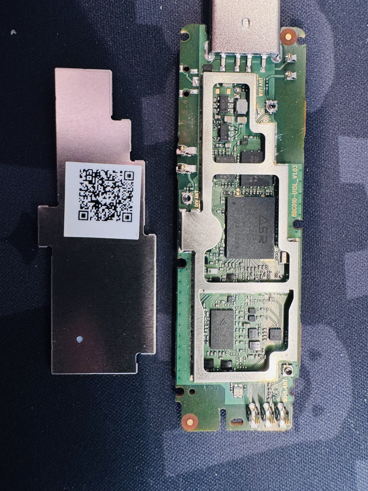
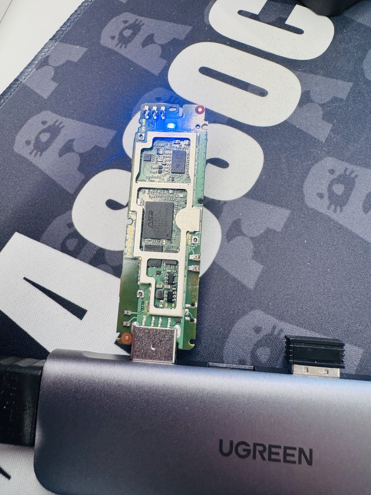

# 超迅捷 E8372-821 随身 Wi-Fi 解锁卡工具

用于解除超迅捷 E8372-821 随身 Wi-Fi 的卡商 SIM 绑定校验，让设备可以使用自己的 SIM 卡上网。工具从自己的设备备份中生成修改固件，提供备份、刷写、读回校验和原版恢复功能；已在 L01 和 M02 各一台设备上实测使用自己的移动 SIM 上网。

**适配硬件：** 主板 `8BC010-U15L_V1.03`、主控 `ASR1803S`。

| 原固件完整版本 | 准备方式 |
| --- | --- |
| `U15L-MT02B01V15-L01` | 本机备份生成；也支持另行提供的已验证 L01 固定组件 |
| `U15L-MT02B01V15-M02` | 仅本机备份生成，使用 `--method local` |

两版均已验证原版恢复、修改版读回、正常重启及手机关闭蜂窝后的 Wi-Fi 网页访问。工具按完整版本和代码指纹匹配补丁；其他卡、型号及 Reset 恢复出厂未验证。

操作见 [指南](docs/guide.md)，适配依据和验证记录见 [技术记录](docs/research.md)。

## 一句话交给agent

```text
请先阅读本项目的 AGENTS.md 和 docs/guide.md，核对设备与环境适配后，为本机接入的随身 Wi-Fi 完成双份备份、生成修改固件与独立恢复包、验证原版恢复并刷入修改版，最后引导我用自己的 SIM 卡验证真实联网。
```

---

<a id="story"></a>

## 破解过程

以下保留最初 L01 设备的实测过程。

随身Wi-Fi是和物联网卡绑定的，不能换自己的sim卡。只能买奸商的套餐。扔了可惜，手头工具齐全，就破解一下试试。

我把照片发给 Codex，让它先找找有没有现成的固件。显然是没找到，只好亲自上阵了。

主板是 `8BC010-U15L_V1.03`，揭开屏蔽罩，芯片上清楚写着 `ASR1803S`。外壳的名字先放一边，后面都按这块板子和这颗芯片找。



闪存只能看清 XMC、25QU，后面被挡住了。从读取结果和启动程序里确认了主闪存容量是 16 MiB。

网上没有找到能确认适配的非绑定固件。那就备份自己的，看看原来的锁到底写在哪里。

全程基本就是：改脚本，双击运行，拔掉，插回去，再检查结果。

失败了很多轮。USB 接口刚出现就消失、程序接到了上一次残留的回应、读取被拒绝，全碰上了。有一次只是把等待时间加长，照样没用。

后来找到两个关键问题。一个是命令顺序：读取前先查询版本，会把启动程序带进另一条流程。另一个是闪存类型：前面试的参数不对，要用 ASR1803 对应的 `QSPI_FLASH = 27`。

一小时后终于读出了两份一样的 4 KiB。窗口里第一次出现成功提示，才觉得这事有戏。

接着读 16 MiB，再核对容量。读到 32 MiB 时，后半段竟然和前半段重复。中间还因为设备重新启动、配置区发生变化，绕了一小圈。最后在同一次上电里连读两遍，才确认是地址回绕；启动程序报告的容量也对上了。

备份有了，终于不用一直拔插，可以坐下来分析固件了。

我的移动卡其实早就被识别到了，管理页面也能看到运营商。但有个状态一直是 `sim_not_match=1`，数据连不上。

解开固件里的压缩代码，顺着这个状态往回找，定位到一段卡商校验：读 SIM 的 ICCID，请求卡商接口，再看返回的 `bindFlag`。不匹配，就断开数据连接。

最后修改了这个函数的入口，让它直接返回匹配。改动只有 4 字节，重新压缩后生成刷写数据。

重新插上，蓝灯亮了。



管理页面里的 `sim_not_match` 变成了 0，数据连接成功，也拿到了 IP 地址。

我用手机连上它，关掉手机自己的蜂窝数据，打开网页，成功了！

### 留给下一位折腾的人

我把这次真正用上的脚本和环境整理成了这个项目，后面遇到相同主板和固件的人，可以接着复用，省得再从找 USB 参数开始。

交给你的agent吧
